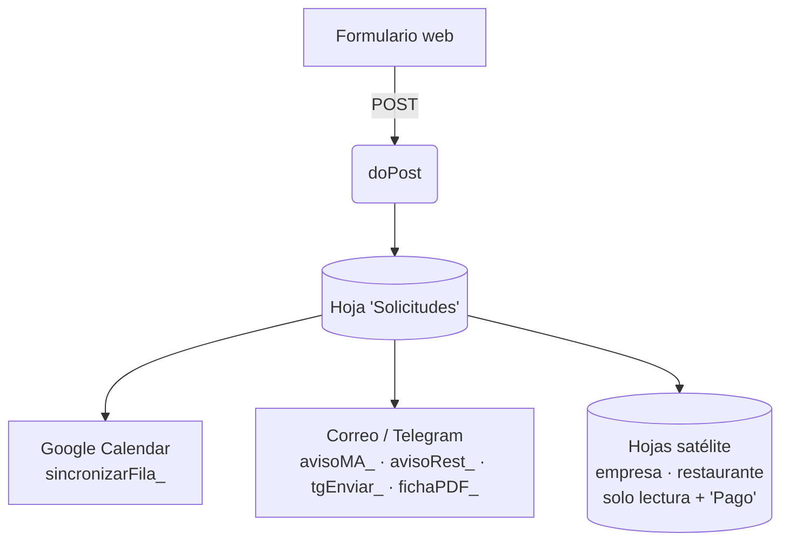

# Sistema de reservas y presupuestos para team building

Backend + frontend completo en **Google Apps Script**, construido como colaborador digital y de automatización de procesos para un cliente del sector turismo de aventura (actividades de team building para empresas, con catering a cargo de un restaurante colaborador). Lleva en producción desde octubre de 2026, procesando el flujo completo de reservas de un negocio real. El código de este repositorio es una versión **anonimizada**: se ha sustituido el nombre del cliente, sus datos de contacto, tokens y URLs por valores de ejemplo, manteniendo intacta toda la lógica de negocio.

## Colaboración de transformación digital

Este sistema es la pieza de automatización de una colaboración más amplia con el cliente, centrada en llevar su operativa de un modelo manual a uno basado en datos y procesos automatizados:

- **Rediseño y modernización web**: rediseño completo del sitio (multilingüe ES/CA/EN), incluyendo el formulario de captación de solicitudes que alimenta este sistema — estructura, campos y flujo diseñados desde cero para automatizar lo que antes se gestionaba a mano.
- **Automatización de procesos**: sustitución de un flujo manual por correo/WhatsApp (el que resuelve este repositorio) por un sistema que centraliza datos, calcula automáticamente y notifica a cada interesado.
- **Datos como base de la operación**: toda la gestión de reservas, disponibilidad y facturación vive en una fuente de datos única (Google Sheets), con lógica de validación y cálculo en vez de hojas sueltas y copia manual.
- **Identidad y comunicación digital**: trabajo de branding y materiales (identidad visual, QR, textos) que acompañan la transformación del negocio hacia lo digital.

## Lo que demuestra este proyecto

- **Automatización de principio a fin**: de una solicitud de presupuesto a una reserva confirmada, sin intervención manual — captación, validación, cálculo, notificación y cobro.
- **Integración de varios sistemas**: Google Sheets como base de datos, Google Calendar para disponibilidad, Gmail y la API de Telegram Bot para notificaciones, todo orquestado desde un único backend.
- **Lógica de negocio real**: cálculo de importes y desglose de IVA, control de aforo por franjas horarias, prevención de solapes de reserva.
- **Buenas prácticas**: gestión de concurrencia con `LockService` para evitar condiciones de carrera, enlaces de acción firmados con hash para no exponer datos sensibles, configuración desacoplada del código vía `PropertiesService`.
- **Diseño pensado para el usuario final**: páginas y correos generados sin que el cliente necesite cuenta de Google ni conocimientos técnicos.

## Contexto y problema

El cliente recibía las solicitudes de presupuesto de team building a través de varios canales (correo, WhatsApp, y más tarde un formulario de captación propio, diseñado como parte del rediseño de la web), pero todo el seguimiento posterior —responder, bloquear la fecha, avisar al restaurante, calcular importes, cobrar— se hacía a mano. Esto generaba:

- Solapes de reservas (dos grupos confirmando el mismo horario).
- Presupuestos y fichas de reserva hechos a mano, propensos a errores.
- Falta de visibilidad sobre importes pendientes de cobro.
- Coordinación manual y lenta con el restaurante que sirve el catering.

La solución final es una aplicación web (desplegada como *Web App* de Apps Script) que recibe cada solicitud, centraliza todo el ciclo de vida de la reserva en una hoja de Google Sheets, y automatiza las comunicaciones y los cálculos.

## Funcionalidades

- **Alta automática de solicitudes**: `doPost` recibe cada solicitud enviada desde el formulario de captación (diseñado y maquetado desde cero como parte del rediseño de la web), genera una fila en la hoja "Solicitudes" con todos los datos (sin duplicados por referencia) y dispara la sincronización con calendario y avisos.
- **Seguimiento de estado**: cada solicitud pasa por `Pendiente → Aceptado / Rechazado / Cancelado`, con formato condicional en la hoja y flujo distinto para cada transición (confirmación por el cliente desde el correo, cambio manual en la hoja, modificación de la reserva, caducidad de pre-reservas sin confirmar, etc.).
- **Comprobación de disponibilidad y choques de horario**: lógica de aforo por franjas horarias (`choque_`), teniendo en cuenta grupos grandes (que ocupan doble capacidad) y los días bloqueados manualmente o por eventos de todo el día en Google Calendar.
- **Sincronización con Google Calendar**: cada solicitud crea/actualiza/borra un evento según su estado (`sincronizarFila_`), con colores distintos para pendiente y confirmado.
- **Cálculo de presupuesto**: fórmulas en la propia hoja para el importe de gestión sobre actividades (porcentaje configurable sobre base sin IVA) y sobre el catering (% configurable), con desglose de IVA (21 % actividades, 10 % catering).
- **Generación de fichas en PDF**: tres variantes (cliente/empresa, colaborador con el desglose de gestión, restaurante solo con el catering), generadas a partir de una plantilla HTML y convertidas a PDF con `Utilities.newBlob(...).getAs(MimeType.PDF)`.
- **Enrutado de notificaciones a varios destinatarios**: avisos por correo (y, opcionalmente, por Telegram) a la empresa, al colaborador externo y al restaurante, cada uno con la información que le corresponde (el restaurante, por ejemplo, nunca ve los importes de gestión).
- **Avisos por Telegram**: integración con la API de Telegram Bot para espejar cada correo relevante según el destinatario y el rol (colaborador / empresa / restaurante), usando `PropertiesService` para guardar el token del bot y el `chat_id` de cada persona.
- **Flujo de pago**: enlaces únicos (con clave derivada por hash SHA-256) para marcar una reserva o un catering como pagado directamente desde el correo, sin necesidad de entrar a la hoja.
- **Hoja compartida en tiempo real con la empresa y con el restaurante**: dos hojas de cálculo adicionales, de solo lectura salvo la columna de "Pago", que se regeneran automáticamente con cada cambio (incluye un resumen de facturación mensual con IVA desglosado).
- **Reservas de "otros servicios"**: un pequeño formulario interno adicional para bloquear el calendario con reservas que no vienen de ese canal (alquiler de espacio, cumpleaños, etc.), para que la disponibilidad online las tenga en cuenta.
- **Página de "ficha de reserva" y acciones desde el correo**: confirmar, cancelar o modificar la reserva, y marcar pagos, todo servido como páginas HTML (`HtmlService`) sin necesidad de que el cliente tenga cuenta de Google.

## Stack técnico

- **Backend**: Google Apps Script (JavaScript sobre V8), con `SpreadsheetApp`, `CalendarApp`, `MailApp`, `UrlFetchApp`, `PropertiesService`, `LockService` y `CacheService`.
- **Frontend**: HTML/CSS/JavaScript vanilla, servido desde el propio script con `HtmlService.createHtmlOutput`, sin frameworks ni build step.
- **Almacén de datos**: Google Sheets como base de datos (hoja principal de solicitudes + hojas satélite para la empresa y el restaurante).
- **Integraciones**: API de Telegram Bot (mensajería), Google Calendar (disponibilidad y agenda).
- **Seguridad básica**: token comprobado en cada petición (`doPost`/`doGet`), enlaces de acción firmados con un hash (`pagoKey_`, `restKey_`) para evitar que se puedan adivinar o manipular.

## Arquitectura

Todo el estado vive en la hoja "Solicitudes"; el resto de piezas (calendario, hojas satélite, avisos) se recalculan a partir de ella cada vez que cambia una fila, con `LockService` para evitar condiciones de carrera cuando varias peticiones llegan a la vez.

## Configuración

El script no incluye ningún dato real: todos los identificadores sensibles se leen de **Propiedades del script** (`PropertiesService.getScriptProperties()`), con un valor de ejemplo como *fallback* para que el código sea legible. Antes de desplegarlo hay que configurar, en *Configuración del proyecto → Propiedades del script*:

| Propiedad | Para qué sirve |
|---|---|
| `TOKEN` | Token compartido entre el formulario de captación y `doPost`/`doGet`. |
| `CAL_ID` | ID del calendario de Google donde se crean los eventos de las reservas. |
| `EXEC_URL` | URL de la Web App una vez implementada (se usa para generar los enlaces de los correos). |
| `TELEGRAM_TOKEN` | Token del bot de Telegram, si se activan los avisos por Telegram. |
| `MA_ID`, `REST_ID`, `MAIN_ID` | IDs de las hojas de cálculo satélite (empresa y restaurante) y, opcionalmente, de la hoja principal. |
| `EVA_KEY` | Clave del formulario interno de "otras reservas" (se genera sola la primera vez si no existe). |

Pasos para desplegarlo desde cero:

1. Crear una hoja de Google Sheets nueva y abrir el editor de Apps Script.
2. Ejecutar `setup()` una vez (crea las pestañas "Solicitudes" y "Resumen" con formato y fórmulas).
3. Ejecutar `instalarCalendario()` y `instalarReservas()`.
4. Rellenar las propiedades del script de la tabla anterior.
5. Implementar el proyecto como aplicación web (acceso: cualquier usuario, incluso anónimo) y apuntar el formulario de captación al nuevo `EXEC_URL`.

## Nota sobre este repositorio

Este código se publica con fines de portfolio. Se ha mantenido toda la lógica y estructura original, pero se han sustituido el nombre de la empresa, el restaurante colaborador, direcciones, teléfonos, correos, tokens, IDs de calendario/hoja y URLs de despliegue por valores de ejemplo. No es un proyecto funcional "tal cual": necesita sus propias Propiedades del script y su propia hoja de cálculo para funcionar.
